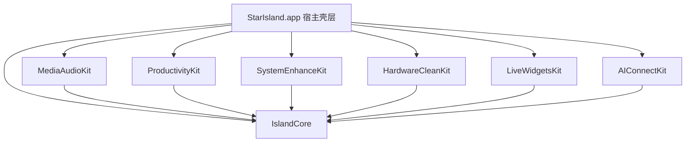

# 星岛（StarIsland）全功能原生 macOS 灵动岛系统架构设计规格说明书

- **文档日期**：2026-11-05
- **项目名称**：星岛（英文名：`StarIsland`）
- **工程路径**：`/Volumes/D盘/mirasim_work/mac灵动岛/StarIsland`
- **主程序标识**：`com.adgry.starisland`
- **特权守护进程标识**：`com.adgry.starisland.helper`
- **远端发布仓库**：`https://github.com/adgry/StarIsland`
- **最低系统要求**：macOS 14.0+（针对 Apple Silicon `arm64` 与 macOS 15/26 深度适配）
- **界面语言**：100% 原生简体中文（`zh-Hans`）

---

## 1. 背景与核心设计原则

### 1.1 立项背景
现有开源版灵动岛项目（如 `Sapphire` 开源版）存在三大结构性痛点：
1. **大量高级功能仅为闭源空壳桩（Stubs）**：如验证码去重为空函数导致普通聊天数字死循环弹窗、Dock 窗口预览/窗口切换器/文件压缩/离线 OCR/圈选搜索/键鼠增强/应用锁/体育财经/跨端互联等模块均为空实现或受商业订阅门控拦截；
2. **代码耦合严重**：设置界面单文件超过 13,700 行，状态管理分散，难以维护与并行演进；
3. **macOS 新系统权限与守护进程摩擦多**：免开发者证书（Ad-hoc）构建在本地网络触发、自动化静默探测、特权 Helper 升级重连等环节易出现误报错。

### 1.2 核心设计原则
1. **零付费墙与全功能真实实现**：系统底层不设任何 `SubscriptionTier`、`Paywall` 或商业账户体系；全部核心功能与高阶生产力模块均为一等公民原生实现，仅由用户本地开关与系统权限状态控制。
2. **微内核 + 本地 Swift Package 模块化架构**：主应用壳工程仅负责进程生命周期、窗口承载与权限引导；核心引擎与 6 大业务域拆分为独立 Swift Package Target，单文件严格控制在 300～600 行以内，模块间通过强类型事件总线与协议通信。
3. **单总线低开销系统监控**：全局键盘/鼠标拦截统一收口至唯一的 `EventTapBus`（按优先级分发并支持快速放行），窗口元数据统一收口至按需启停的 `WindowRegistry`，确保空闲 CPU 占用低于 1%。
4. **可验证驱动（TDD）与分阶段可运行交付**：全系统划分为 6 个递进阶段（Phase 1 ～ Phase 6），每个阶段结束均产出可独立通过 `swift test` 单元测试并编译打包为 `StarIsland.app` 实机运行的完整版本。

---

## 2. 总体目录与模块拓扑

```text
/Volumes/D盘/mirasim_work/mac灵动岛/StarIsland/
├── docs/
│   └── superpowers/
│       ├── specs/2026-11-05-starisland-design.md
│       └── plans/
├── Packages/
│   └── StarIslandKit/                  # 核心本地 Swift Package（macOS 14+）
│       ├── Package.swift
│       ├── Sources/
│       │   ├── IslandCore/             # 微内核：窗口状态机、配置存储、事件总线、权限中心、自更新
│       │   ├── MediaAudioKit/          # 模块 1：媒体控制、同步歌词、实时频谱、8D/环绕音效、系统 HUD
│       │   ├── ProductivityKit/        # 模块 2：智能验证码/快递、剪贴板选择器/URL净化、暂存架、文件压缩、OCR与圈选
│       │   ├── SystemEnhanceKit/       # 模块 3：窗口磁吸、Dock实时预览、窗口切换器、键鼠增强、Emoji联想、应用锁
│       │   ├── HardwareCleanKit/       # 模块 4：XPC客户端、电池充电/温控管家、风扇控制、深度卸载、空间分析、DMG安装
│       │   ├── LiveWidgetsKit/         # 模块 5：天气、日历/提醒、蓝牙电量、体育比分、股票加密看板、计时/护眼/随身镜/专注
│       │   └── AIConnectKit/           # 模块 6：多模型 AI 灵动助手（Gemini/OpenAI/Ollama）+ 手机扫码局域网互联
│       └── Tests/
│           ├── IslandCoreTests/
│           ├── MediaAudioKitTests/
│           ├── ProductivityKitTests/
│           ├── SystemEnhanceKitTests/
│           ├── HardwareCleanKitTests/
│           ├── LiveWidgetsKitTests/
│           └── AIConnectKitTests/
├── App/                                # StarIsland.app 主应用壳层（Info.plist、权限描述、菜单栏、启动编排）
├── Helper/                             # com.adgry.starisland.helper 特权守护进程源码与 LaunchDaemon plist
├── scripts/
│   ├── build_app.sh                    # 本地确定性构建组装与 Ad-hoc 双层签名脚本
│   └── release.sh                      # 自动递增版本号/构建号、打包 StarIsland-arm64.zip 并发布 GitHub Release
└── .github/workflows/
    └── release.yml                     # GitHub Actions 云端自动构建与发布流水线
```

### 模块依赖有向无环图（DAG）



> **约束**：6 大业务模块仅依赖 `IslandCore`（仅 `ProductivityKit` 的圈选识图可通过 `IslandCore` 定义的 `AIQueryServiceProtocol` 协议将图像/文本转发给 `AIConnectKit`，从而保持 6 大业务模块在编译期完全无交叉依赖，支持 100% 并行开发与独立单测）。

---

## 3. 微内核设计（`IslandCore`）

### 3.1 多屏刘海自适应宿主窗口（`IslandWindowController`）
- **窗口承载**：为每块启用的显示器创建独立的 `IslandPanel`（继承自 `NSPanel`），样式掩码采用 `[.borderless, .nonactivatingPanel]`，窗口行为设为 `[.canJoinAllSpaces, .stationary, .fullScreenAuxiliary, .ignoresCycle]`，窗口层级高于菜单栏（`NSMainMenuWindowLevel + 3`）。
- **物理刘海与普通屏幕几何自适应**：
  - 若 `NSScreen.safeAreaInsets.top > 0` 且存在 `auxiliaryTopLeftArea` / `auxiliaryTopRightArea`，精确计算物理刘海宽度 `notchWidth = screen.frame.width - leftArea.width - rightArea.width` 与刘海高度 `notchHeight = safeAreaInsets.top`；
  - 若为无刘海外接显示器，采用视觉协调的虚拟顶部灵动胶囊基准尺寸（默认 `184 × 32 pt`，支持在设置中微调缩放比例）。
- **锁屏灵动岛支持**：监听 `com.apple.screenIsLocked` / `com.apple.screenIsUnlocked` 分布式通知；启用“锁屏显示灵动岛”时切换对应安全视图模式（锁屏下自动隐藏剪贴板隐私内容与受锁应用信息，仅展示时间、天气、媒体控制与计时实时活动）。

### 3.2 五态弹簧状态机（`IslandStateMachine`）
| 状态 | 触发条件 | 几何与交互行为 |
| --- | --- | --- |
| `compact` | 无活跃实时活动且鼠标未悬停 | 贴合刘海或收起为极窄顶部胶囊，不遮挡菜单栏图标，点击穿透周边透明区域 |
| `pill` | 存在常驻实时活动（音乐播放、计时器、体育比分、终端任务等） | 左右翼对称或非对称延展，左侧展示主状态图标/封面，右侧展示音波/倒计时/比分 |
| `peek` | 新事件到达（切歌、日程提醒、蓝牙连接、文件入架） | 向下轻弹圆角卡片展示 2.5～4 秒关键摘要，鼠标移入可无缝升级为 `expanded` |
| `expanded` | 鼠标悬停满可配置延迟（默认 `180ms`）或点击灵动岛 / 拖拽文件靠近顶部 | 阻尼弹簧展开主工作台面板（支持切换：**正在播放 / 暂存架 / 全景看板 / AI 助手 / 手机互联** 五大标签页） |
| `alertHUD` | 音量/亮度/背光调节、新验证码到达、应用锁提示 | 高优先级瞬态浮层，带独立超时自动回退至前一稳态 |

### 3.3 实时活动仲裁与永久去重引擎（`LiveActivityCoordinator` & `ConsumedEventStore`）
- **优先级队列**：`critical (100: 应用锁/硬件告警)` > `urgent (80: 验证码/来电通知)` > `interactive (60: 音量亮度HUD/暂存架拖拽)` > `ongoing (40: 音乐/计时器/体育实况/终端任务)` > `ambient (20: 护眼提醒/天气速览)`。
- **去重保证（`ConsumedEventStore`）**：
  - 采用 SQLite / JSON 原子落盘环形缓存（保留最近 500 条事件 SHA-256 指纹，默认有效期 24 小时）；
  - **先落盘后展示契约**：任何外部事件（通知验证码、快递状态变更、邮件提醒）在进入 `LiveActivityCoordinator` 时，必须先通过 `tryConsume(fingerprint:)` 原子校验；若返回 `false` 直接丢弃，彻底根绝重复无限弹窗。

### 3.4 统一配置、权限中心与 GitHub 自更新
- **`SettingsStore`**：基于 `@Observable` + `Codable` 结构化 JSON 存储（`~/Library/Application Support/StarIsland/settings.json`），支持全中文拼音/关键词模糊搜索索引、配置一键导入导出与恢复默认。
- **`PermissionsCenter`**（吸收 macOS 15/26 全部实战经验）：
  - **辅助功能**：定时轻量轮询 `AXIsProcessTrusted()`（双次确认防抖，避免瞬态误判）；
  - **本地网络**：`Info.plist` 预声明 `_starisland._tcp`、`_airplay._tcp`、`_raop._tcp`，探测时同步执行 Bonjour 浏览与 `224.0.0.251:9` UDP 局域网多播触发内核 NECP 弹窗，且**仅将 `kDNSServiceErr_PolicyDenied (-65570)` 判定为已拒绝**，并提供一键“重新检测”；
  - **自动化**：使用 `NSWorkspace.OpenConfiguration`（`promptsUserIfNeeded = false`, `activates = false`）静默探测已安装的 `Music`、`Spotify`、`System Events`、`Mail`、`Terminal`，绝不向未安装/损坏应用弹出 Finder 报错框；
  - **屏幕录制、日历、提醒事项、定位、蓝牙、通知、完全磁盘访问**：统一状态徽章与直达 `x-apple.systempreferences:` 对应隐私锚点。
- **`SelfUpdater`（软件内更新）**：
  - 对接 `https://api.github.com/repos/adgry/StarIsland/releases/latest`；
  - 语义化版本对比（`3.x.y`）+ 压缩包 `StarIsland-arm64.zip` 下载校验 + 递归清除 `com.apple.quarantine` 扩展属性；
  - 若 `/Applications/StarIsland.app` 当前用户可写则直接原子替换重启，否则优先通过已运行的特权 Helper 执行无感替换，最后才回退至系统管理员授权提示。

---

## 4. 六大业务模块详细规格

### 4.1 模块 1：媒体、歌词与空间音效（`MediaAudioKit`）
1. **多源媒体控制器（`NowPlayingService`）**：
   - 支持系统 `MediaRemote` 全局正在播放读取（兼容 Safari/Chrome/Bilibili/网易云/QQ音乐/Apple Music/Spotify）与针对 Apple Music / Spotify 的精确进度跳转、喜爱收藏、循环/随机控制；
   - 提取专辑封面主色调，驱动灵动岛背景流体渐变与动态阴影。
2. **逐行/逐字同步歌词引擎（`LyricsService`）**：
   - 免 Key 并行检索 `LRCLIB`（`https://lrclib.net/api/get`）与公开 LRC 歌词源，本地缓存至 `~/Library/Caches/StarIsland/Lyrics/`；
   - 支持灵动岛收起态单行滚动歌词、展开态卡拉 OK 高亮歌词与桌面悬浮歌词条。
3. **实时音频频谱与 8D / 环绕空间音效（`SpatialAudioProcessor`）**：
   - 利用 macOS 14.2+ `CoreAudio` 进程音频 Tap / `ScreenCaptureKit` 音频流实时执行 32 频段 FFT，渲染 60fps 丝滑声波柱；
   - 内置基于 `AVAudioEngine` + `AVAudioEnvironmentNode` + `AVAudioUnitEQ` 的音效增强管线：支持**空间环绕声（Surround）**与**8D 环绕旋转声场**（可调旋转速率 `0.05Hz ～ 0.5Hz`、混响房间大小与低音增强）。
4. **原生系统 HUD 接管（`SystemHUDInterceptor`）**：
   - 接管媒体功能键（音量加减、静音、屏幕亮度、键盘背光）及 AirPods / 蓝牙音频连接事件，在灵动岛 `alertHUD` 态展示细腻进度条与数值百分比。

### 4.2 模块 2：智能通知、效率工具箱与原生视觉（`ProductivityKit`）
1. **高精准验证码与快递识别（`SmartCodeDetector`）**：
   - **双因子验证码判定规则**：
     1. 文本中必须包含验证码语义词（中文：`验证码|校验码|动态码|确认码|安全码|认证码|口令|登录码`；英文：`verification|verify|passcode|otp|auth code|security code|login code|two-factor|2fa|one-time`）；
     2. 提取紧邻语义词或全文符合规则的 `4～8` 位数字/字母数字组合，自动排除年份（`2020-2035`）、时间（`12:30`）、金额（`¥1000`）与纯群聊普通数字；
     3. 计算 `SHA256(appBundleID + title + body + code)` 写入 `ConsumedEventStore`，支持“自动复制到剪贴板”与灵动岛一键复制后自动收起。
   - **快递物流提取**：正则识别顺丰、京东、中通、圆通、申通、韵达、EMS、UPS、FedEx、DHL 单号并在看板中展示快捷查询入口。
2. **可视化剪贴板中心与链接净化（`ClipboardManager`）**：
   - 监听 `NSPasteboard.general.changeCount`（自动忽略密码管理器标记的 `org.nspasteboard.ConcealedType` 隐私条目）；
   - SQLite 本地存储文本、图片缩略图、文件引用与来源应用图标，支持全局快捷键（默认 `⌥⌘V`）在当前光标/屏幕中心呼出浮层选择器（回车直接模拟 `⌘V` 粘贴到前台应用）；
   - 支持**隐私倒计时自动清空**与**URL 追踪参数自动清洗**（剥离 `utm_*`、`fbclid`、`gclid`、`spm`、`vd_source`、`igshid` 等参数）。
3. **灵动文件暂存架与本地媒体压缩转换（`DropzoneShelf` & `MediaToolbox`）**：
   - 拖拽任意文件/图片/文本至屏幕顶部自动展开暂存架，支持多文件合并拖出、AirDrop 分享与快捷处理动作；
   - **纯本地媒体优化器**：
     - 图片：基于 `ImageIO` 压缩 PNG/JPEG/HEIC/WebP 并支持格式互转与去除 EXIF 定位信息；
     - PDF：基于 `PDFKit` + `Quartz` 重采样内嵌图像减小体积；
     - 音视频：基于 `AVAssetExportSession` 压缩 MP4/MOV 为高性价比 HEVC/H.264 或提取 M4A 音频。
4. **离线 OCR 与圈选搜索（`VisionOCRService` & `CircleToSearchController`）**：
   - 全局快捷键（默认 `⇧⌘2` OCR、`⇧⌘S` 圈选搜索）呼出全屏瞬时冻结框选层；
   - 调用 Apple `Vision` 框架（`VNRecognizeTextRequest`，`.accurate` 级别，语言优先 `["zh-Hans", "zh-Hant", "en-US", "ja-JP"]`）毫秒级离线提取文字与条码/二维码；
   - 选区下方弹出浮动工具条：**复制文字 / 翻译文字 / AI 识图解答 / 以图搜图（浏览器打开）**。

### 4.3 模块 3：窗口管理、Dock 预览与键鼠安全增强（`SystemEnhanceKit`）
1. **统一事件与窗口基础设施**：
   - **`EventTapBus`**：进程内唯一 `CGEvent.tapCreate` 实例，按处理器掩码与优先级链式调度；若系统瞬间超时禁用 Tap（`tapDisabledByTimeout`）则自动毫秒级重连；没有任何功能开启时自动释放 Tap 零开销。
   - **`WindowRegistry`**：通过 `CGWindowListCopyWindowInfo` 与 `AXUIElement` 缓存桌面窗口位置、标题与所属 PID，供磁吸、Dock 预览和窗口切换器共享。
2. **窗口磁吸分屏与增强切换器（`WindowSnapManager` & `WindowSwitcherPanel`）**：
   - 拖拽窗口至左/右边缘（左半/右半）、顶部（全屏填满）、四角（四分屏）展示毛玻璃预览框，松手通过 `AXUIElementSetAttributeValue` 精准落位；同时支持全局分屏快捷键；
   - 增强型窗口切换器：展示所有打开窗口的实时缩略图、窗口标题与应用角标，支持方向键/首字母快速跳转。
3. **Dock 悬停实时预览与 Dock 增强（`DockPreviewController`）**：
   - 定位 `com.apple.dock` 的 `AXList` 子元素坐标，鼠标悬停在已运行应用的 Dock 图标上时，弹出毛玻璃预览浮层，使用 `ScreenCaptureKit`（`SCScreenshotManager`）渲染该应用所有窗口的实时画面，支持点击激活指定窗口、中键/关闭按钮直接关窗、点击当前已激活的 Dock 图标一键隐藏/最小化，以及 Dock 常用应用布局备份与切换。
4. **键鼠效率增强套件**：
   - **长按 `⌘Q` 防误触退出**：拦截单次短按 `⌘Q`，在灵动岛显示“继续按住 `⌘Q` 退出应用”环形进度条（支持应用白名单）；
   - **Finder `⌘X` 剪切粘贴**：在 Finder 前台捕获 `⌘X` 记录待移动路径，捕获 `⌘V` 时自动转换为原生 `⌥⌘V`（移动项目到这里）；
   - **绿灯按钮真最大化**：支持按住或单击窗口左上角绿色按钮时执行桌面填满最大化而非进入新建独立全屏空间；
   - **外接鼠标与键盘调校**：鼠标滚轮平滑插值、鼠标与触控板独立自然滚动方向、焦点跟随鼠标、微动开关防双击连点过滤（可调阈值 `15～80ms`）、机械键盘按键消抖过滤；
   - **全局 `:emoji` 快捷输入**：监听连续键入 `:关键词`（支持中文如 `:大笑`、`:火箭` 及英文 `:rocket`），光标旁弹出轻量候选条一键替换输入。
5. **生物识别应用锁（`AppLockService`）**：
   - 用户勾选需加锁的敏感应用（如微信、备忘录、相册、设置等）；
   - 监听 `NSWorkspace.didActivateApplicationNotification`，当目标应用切至前台且未处于解锁有效期内时，立即覆盖全屏高优先级磨砂锁定层并隐藏原窗口内容，自动拉起 `LAContext`（**Touch ID 指纹或系统登录密码**），验证通过后瞬间放行，切出后台超可配时长后自动重新上锁。

### 4.4 模块 4：硬件管家与系统空间清理（`HardwareCleanKit`）
1. **特权辅助服务（`com.adgry.starisland.helper`）**：
   - 通过 `SMAppService.daemon` 注册；XPC 监听器内置 `CodesignValidator`，同时兼容 Developer ID Team 签名与本地 Ad-hoc 构建（严格校验客户端二进制位于守护进程自身所在的父级 `StarIsland.app` 包内且代码签名完整有效，`root` 权限正常运行）；
   - `HelperCoordinator` 严格遵循：**握手未完成前显示“正在连接”绝不误报红叉；重装升级时先关闭 XPC 连接等待端口释放，再执行 `unregister` → `register`**。
2. **智能电池与风扇控制（`BatteryFanManager`）**：
   - 通过 Helper 读写 Apple Silicon SMC 充电与风扇键值（如 `CH0B`/`CH0C`/`BCLM` 及 `F0Md`/`F0Tg` 等机种自适应探测，退出或卸载时通过 `MutationJournal` 安全恢复系统自动状态）；
   - 支持**自定义充电上限（60%～100%，推荐 80%）**、**巡航模式**（回落至上限减 5% 再补电，避免微充损耗）、**高温保护**（电池温度超阈值自动暂停充电并在灵动岛告警）以及**风扇静音/均衡/全速/自定义温控曲线**。
3. **深度应用卸载、存储分析与 DMG 安装助手（`AppCleanerService` & `DMGAutoInstaller`）**：
   - **应用深度卸载器**：列出 `/Applications` 应用体积与上次使用时间，卸载时自动关联扫描 `~/Library/{Application Support,Caches,Preferences,Saved Application State,Containers,Group Containers,LaunchAgents}` 下匹配 Bundle ID 与应用名的残留文件，勾选确认后移入废纸篓并统计释放空间；
   - **存储空间小组件**：实时展示系统盘可用容量、内存压力与快捷清理入口；
   - **DMG 一键安装助手**：拖入或打开 `.dmg` 镜像时可自动挂载、`ditto` 拷贝 `.app` 至 `/Applications`、清除隔离属性并自动卸载删除源安装包。

### 4.5 模块 5：全景小组件与实时活动中心（`LiveWidgetsKit`）
全部外部数据源均采用**免 API Key 公开稳定接口**，带本地指数退避缓存，断网优雅降级：
1. **实时天气（`WeatherService`）**：基于 `CoreLocation`（或手动城市搜索 `geocoding-api.open-meteo.com`）请求 `api.open-meteo.com/v1/forecast`，提供当前气温、体感、降水概率、24 小时趋势与未来 7 天预报。
2. **体育实时比分（`SportsLiveService`）**：对接 ESPN 公开记分牌接口（`site.api.espn.com/apis/site/v2/sports/.../scoreboard`），覆盖 NBA、英超/西甲/欧冠、MLB、NFL、F1；关注的比赛开赛时自动常驻灵动岛 `pill` 双侧展示主客队缩写与实时比分，进球/得分触发灵动岛庆祝动画。
3. **股票与加密货币实时看板（`FinanceLiveService`）**：对接 Yahoo Finance 图表接口（支持美股如 `AAPL`/`NVDA`、港股如 `0700.HK`、沪深指数）与 Binance 24h 行情接口（`BTCUSDT`/`ETHUSDT`/`SOLUSDT`），绘制迷你分时火花线（Sparkline）并支持涨跌幅阈值提醒。
4. **原生个人效率与实用工具组件**：
   - `EventKit` 日历近期会议倒计时（一键加入 Zoom / 腾讯会议 / 飞书会议链接）与提醒事项勾选；
   - 蓝牙连接设备（AirPods、Magic Keyboard/Trackpad 等）实时电量环；
   - 多路计时器、秒表、番茄钟与 **20-20-20 护眼休息提醒**；
   - **高清随身镜**：调用前置摄像头在灵动岛展开区内提供圆角实时镜像预览（支持水平翻转与补光边框）；
   - **终端命令实时活动**：提供一行 Shell Hook（写入 `~/.zshrc` 可选启用），耗时超过 5 秒的终端构建/脚本在灵动岛显示运行动画，结束时弹出成功/失败退出码通知；
   - **专注模式防分心引擎**：开启专注时段后自动静音干扰通知、拦截黑名单娱乐应用启动，并可通过 Helper 临时屏蔽分心网站域名（专注结束或异常退出通过 `MutationJournal` 自动还原）。

### 4.6 模块 6：AI 灵动助手与局域网跨端互联（`AIConnectKit`）
1. **多引擎 AI 灵动岛工作台（`AIAssistantService`）**：
   - 统一 `AIProvider` 协议，内置三大适配器（密钥全部存入 macOS `Keychain`，绝不明文落盘）：
     1. **Google Gemini**（支持 Gemini 2.5 Flash/Pro 文本、图像理解与 WebSocket 实时语音交互）；
     2. **OpenAI 兼容接口**（自定义 `Base URL` + `API Key` + 模型名，无缝接入 OpenAI、DeepSeek、通义千问、硅基流动等）；
     3. **本地 Ollama**（默认连接 `http://127.0.0.1:11434`，零云端成本离线对话与翻译）；
   - 支持灵动岛内连续多轮对话、一键附带当前剪贴板或前台窗口截图提问、划词中英互译与语音朗读/听写。
2. **手机免装 App 扫码局域网互联（`LANContinuityServer`）**：
   - 基于 `Network.framework` 启动本地局域网 HTTP + WebSocket 服务并通过 Bonjour 广播 `_starisland._tcp`；
   - 灵动岛“手机互联”标签页实时生成带一次性 6 位安全配对码的局域网 URL 二维码；
   - Android / iPhone 手机相机扫码即可在手机浏览器打开内嵌的现代响应式中文 Web 控制台（支持添加到主屏幕作为 PWA），无需安装任何第三方客户端即可实现：
     - **双向极速文件与相册快传**（流式分块上传至 Mac 下载目录 / 暂存架，或将 Mac 暂存架文件一键推送至手机下载）；
     - **双向剪贴板实时同步**；
     - **手机端遥控 Mac 媒体播放、音量与锁屏**。

---

## 5. 阶段划分与里程碑验收标准

为保证架构稳固、测试完备且每一步均可直接运行验证，整体实施按以下 **6 个连续阶段（Phases）** 推进：

1. **Phase 1：微内核底座、媒体音效、系统 HUD、设置中心与 GitHub 自更新**
   - 交付 `StarIslandKit` 工程骨架、`IslandCore`（多屏刘海适配、五态状态机、锁屏支持、`ConsumedEventStore`、配置中心、权限引导中心、GitHub 自更新）与 `MediaAudioKit`（系统媒体控制、LRCLIB 同步歌词、实时频谱、8D/环绕音效、音量/亮度/背光 HUD），以及完整中文设置窗口与打包脚本。
   - **验收标准**：`IslandCoreTests` 与 `MediaAudioKitTests` 全部通过；生成签名完整的 `/Applications/StarIsland.app` 实机运行，灵动岛弹簧交互、音乐歌词频谱与系统 HUD 正常响应。
2. **Phase 2：智能通知验证码、剪贴板选择器、暂存架、媒体压缩与离线 OCR 圈选**
   - 交付 `ProductivityKit` 全部能力与对应设置页。
   - **验收标准**：`ProductivityKitTests` 覆盖验证码正反例（普通聊天数字 100% 不误报、同一验证码 100% 不二次弹出）、URL 净化规则、本地图片/PDF 压缩与 Vision OCR 识别测试全部通过。
3. **Phase 3：窗口磁吸、Dock 实时窗口预览、键鼠全套增强与生物识别应用锁**
   - 交付 `SystemEnhanceKit`（`EventTapBus`、`WindowRegistry`、磁吸分屏、窗口切换器、Dock 悬停预览、Finder 剪切、长按 `⌘Q`、绿灯最大化、键鼠调校、`:emoji` 联想、Touch ID 应用锁）。
   - **验收标准**：`SystemEnhanceKitTests` 通过；实机验证窗口磁吸、Dock 预览与 Touch ID 应用锁解锁闭环。
4. **Phase 4：特权辅助服务、SMC 电池风扇管家、应用深度卸载与 DMG 安装器**
   - 交付 `Helper` 守护进程与 `HardwareCleanKit`（电池充电上限/巡航/高温保护、风扇控制、应用残留扫描卸载、存储组件、DMG 自动安装）。
   - **验收标准**：`HardwareCleanKitTests` 通过；特权 Helper 握手连通无误报，卸载扫描与安全恢复日志验证通过。
5. **Phase 5：全景小组件与免费公开源体育/财经实时活动**
   - 交付 `LiveWidgetsKit`（Open-Meteo 天气、EventKit 日程提醒、蓝牙电量、ESPN 实时比分、股票/加密行情、计时器/秒表/护眼、随身镜、终端完成提醒、专注拦截）。
   - **验收标准**：`LiveWidgetsKitTests`（含网络解析与离线降级单测）全部通过，灵动岛小组件看板与实况胶囊正常渲染。
6. **Phase 6：多模型 AI 灵动助手、手机扫码跨端互联与 GitHub 正式发版**
   - 交付 `AIConnectKit`（Gemini / OpenAI 兼容 / Ollama 助手与局域网扫码双向快传互联），创建并推送 `adgry/StarIsland` 远端仓库，运行 `scripts/release.sh 1.0.0` 发布首个全功能正式版安装包并实机全链路验收。
   - **验收标准**：全部 7 个模块单元测试 100% 通过，`StarIsland v1.0.0` 安装包成功上传至 `adgry/StarIsland` GitHub Releases 且本机 `/Applications/StarIsland.app` 实机运行稳定。

---

## 6. 错误处理与安全边界

1. **崩溃与副作用自愈（`MutationJournal`）**：凡涉及修改系统级状态的操作（SMC 充电抑制、手动风扇模式、专注模式 `/etc/hosts` 屏蔽、外接鼠标系统参数），修改前一律写入本地原子日志；应用正常退出或异常崩溃后下次启动时自动比对并恢复系统默认状态。
2. **隐私与凭据安全**：所有 AI API Key 仅存储于 macOS `Keychain`（Service: `com.adgry.starisland.ai-keys`）；剪贴板自动跳过密码管理器敏感标记；局域网手机互联强制校验一次性动态 6 位配对令牌（PIN），未授权局域网设备无法读写剪贴板或传输文件。
3. **无网络与外部接口容错**：天气、歌词、体育、财经与 AI 请求均设置明确超时（`8s`）与本地缓存兜底，任何外部接口波动均不会阻塞主线程或影响灵动岛动画帧率。
